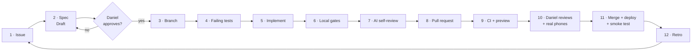

# Daniel Dominic — Portfolio

**A personal portfolio built by an AI coding agent, with a human in charge.**

Claude Code writes the code, the tests and the drafts. Daniel decides what gets built, approves every spec, reviews every pull request, and is the only one who merges and ships. Guardrails sit between the two: tests, hooks, permissions, CI budgets and a separate AI reviewer. Together they turn "the agent says it's done" into "the checks prove it's done".

This README covers how that works, what's built so far, what was learned along the way, and what comes next.

> **Status (22 October 2026):** Sprint 0 (Foundation) is complete. A placeholder page is live and marked `noindex`. Phase 0 (content) is next.
> **Live:** https://portfolio-mu-inky-3anc9yn1ky.vercel.app

---

## The short version

Sprint 0's story in six beats:

1. **Humans decide, agents execute.** Daniel owns the what and the why. Claude Code does the typing.
2. **Spec before code.** Every change starts as a written spec with numbered acceptance criteria. Nothing is built until Daniel marks it Approved.
3. **Tests are the contract.** Each acceptance criterion becomes a test, written _before_ the code, and seen failing first.
4. **Guardrails beat instructions.** Anything that must always happen is enforced by a hook, a permission rule or a CI gate, not by asking the agent nicely.
5. **A second AI reviews the first.** A read-only reviewer agent checks every branch against its spec, in a fresh context that didn't write the code.
6. **Prove the loop on something tiny.** Sprint 0 took a one-line placeholder page through all 12 stages, from GitHub issue to a production smoke test, before anything real gets built.

---

## At a glance

| Item                    | Sprint 0 result                                                                          |
| ----------------------- | ---------------------------------------------------------------------------------------- |
| Pull requests merged    | 12, each one slice, squash-merged by Daniel                                              |
| Foundation slices       | 11 (S1–S11)                                                                              |
| Required CI checks      | 6: `static`, `typecheck`, `unit`, `build`, `e2e`, `lighthouse`                           |
| Automated tests         | 142 unit/component, 24 end-to-end runs (8 tests × 3 device profiles), 1 production smoke |
| Device profiles in CI   | Android (Pixel 7), iPhone 14, desktop 1440 px                                            |
| Home page JavaScript    | 137.5 KB of a 150 KB budget, enforced in CI                                              |
| Lighthouse (mobile)     | Performance 0.98–0.99 (gate ≥ 0.90), accessibility 1.0 (gate ≥ 0.95)                     |
| Accessibility gate      | Zero serious or critical axe violations, in light and dark mode                          |
| Who can merge or deploy | Only Daniel. Branch protection and agent permissions enforce it.                         |

---

## Roles

| Daniel (human)                             | Claude Code (agent)                                 | Guardrails (deterministic)                               |
| ------------------------------------------ | --------------------------------------------------- | -------------------------------------------------------- |
| Approves every spec                        | Drafts specs, then stops and waits                  | Branch protection: no direct pushes to `main`            |
| Owns architecture decisions (ADRs)         | Writes failing tests first, then the implementation | Permission rules: no merging, no prod deploy, no secrets |
| Writes every public word into the spec     | Runs the full local check suite before any PR       | Hooks: auto-format, block protected paths                |
| Reads every diff, checks UI on real phones | Runs an independent AI review of its own branch     | CI: 6 required checks, performance and a11y budgets      |
| Merges and ships                           | Writes retros and proposes rule changes             | Post-deploy smoke test on production                     |

---

## The development loop

Every change, however small, goes through the same 12 stages:



| #   | Stage          | Who                    | Done when                                    |
| --- | -------------- | ---------------------- | -------------------------------------------- |
| 1   | Issue          | Daniel / Claude        | A GitHub issue small enough for one PR       |
| 2   | Spec           | Claude drafts          | Daniel changes `Status: Draft` to `Approved` |
| 3   | Branch         | Claude                 | `feat/…` branch, clean and up to date        |
| 4   | Tests first    | Claude                 | Tests fail, for the right reason             |
| 5   | Implement      | Claude                 | Tests pass                                   |
| 6   | Local gates    | Hooks + `pnpm verify`  | Format, lint, types, tests, build, e2e green |
| 7   | Self-review    | Reviewer agent         | No blocking findings                         |
| 8   | Pull request   | `/pr` (Daniel runs it) | Template filled: AC → test map, proof of red |
| 9   | CI + preview   | GitHub Actions, Vercel | All 6 checks green, preview deployed         |
| 10  | Human review   | Daniel                 | Diff read, preview checked on real phones    |
| 11  | Merge + deploy | Daniel                 | Production smoke test passes                 |
| 12  | Learn          | Daniel + Claude        | Lessons written back into the repo           |

The full process is in [docs/workflow.md](docs/workflow.md).

---

## Guardrails, layer by layer

No single layer is trusted on its own. Each one catches what the layer before it misses.

| Layer                    | What it is                                                            | What it stops                                                     |
| ------------------------ | --------------------------------------------------------------------- | ----------------------------------------------------------------- |
| **1. Project memory**    | [`CLAUDE.md`](CLAUDE.md): rules, commands, definition of done         | Drift. Every session starts with the same knowledge.              |
| **2. Specs**             | [`docs/specs/`](docs/specs): goal, scope, numbered criteria           | Building the wrong thing, or more than was asked                  |
| **3. Permissions**       | [`.claude/settings.json`](.claude/settings.json): allow, ask, deny    | Merging, deploying, force-pushing, reading secrets                |
| **4. Hooks**             | [`.claude/hooks/`](.claude/hooks): Node scripts with unit tests       | Unformatted code, writes to secrets, raw assets or test baselines |
| **5. Tests first**       | Vitest + Playwright, written before the code                          | "Done" without proof                                              |
| **6. AI reviewer**       | [`.claude/agents/reviewer.md`](.claude/agents/reviewer.md), read-only | The author grading its own work                                   |
| **7. CI budgets**        | 6 required checks, including Lighthouse and axe                       | Slow pages, bloated JavaScript, accessibility regressions         |
| **8. Proof of red**      | Each new gate is broken on purpose once, and the failing run linked   | Checks that can't actually fail                                   |
| **9. Human checkpoints** | Spec approval, diff review, real-phone check, merge                   | Everything above passing while still doing the wrong thing        |
| **10. Production smoke** | Runs automatically after every production deploy                      | A broken deploy going unnoticed                                   |

Rules that make the layers bite:

- **Never weaken a test to get green.** Never loosen a budget without a PR that says why.
- **Content comes from the spec.** Whatever Daniel writes there ships; the agent may not invent metrics or anything else.
- **Small PRs:** one spec per PR, about 400 changed lines at most.

---

## The agent toolkit

Built in Sprint 0, kept deliberately small:

| Kind     | Name               | What it does                                                                                                    |
| -------- | ------------------ | --------------------------------------------------------------------------------------------------------------- |
| Skill    | `/spec`            | Drafts a spec from the template, asks about anything the repo can't answer, then **stops** for approval         |
| Skill    | `/self-review`     | Hands the branch to the reviewer agent, applies mechanical fixes, and lists judgement calls for Daniel          |
| Skill    | `/pr`              | Fills the PR template (AC → test map, proof of red, decisions) and opens the PR. Only Daniel can trigger it.    |
| Agent    | `reviewer`         | Read-only review against the spec, `CLAUDE.md` and the ADRs. Reports a verdict, findings and the AC → test map. |
| Hook     | `protect-paths`    | Blocks edits and shell commands that touch secrets, raw assets, visual baselines or the resume PDF              |
| Hook     | `format-on-write`  | Runs ESLint and Prettier on every file the agent writes, and reports remaining problems back to it              |
| Workflow | `Production smoke` | Runs Playwright against the live site after each production deploy                                              |

Each piece has its own tests. A contract test, for example, fails CI if the reviewer agent is ever given write tools.

---

## What Sprint 0 built

| Slice | What                                                             | PR  |
| ----- | ---------------------------------------------------------------- | --- |
| S1    | Plan, workflow, spec template, first architecture decision (ADR) | —   |
| S2    | Next.js 16 + React 19 + TypeScript scaffold, CI skeleton         | #1  |
| S3    | ESLint + Prettier, `static` CI job                               | #2  |
| S4    | Vitest unit tests, `unit` CI job                                 | #3  |
| S5    | Playwright end-to-end tests + axe on 3 device profiles           | #4  |
| S6    | Lighthouse CI with a 150 KB JavaScript budget                    | #5  |
| S7    | `CLAUDE.md`, agent permissions, settings contract test           | #6  |
| —     | Trimmed the agent setup to what Sprint 0 actually needs          | #7  |
| S8    | Hooks: format-on-write and protect-paths                         | #8  |
| S9    | Reviewer agent and the `/spec`, `/self-review`, `/pr` skills     | #9  |
| S10   | Automatic production smoke test and rollback steps               | #10 |
| S11   | Placeholder home page, taken through the full 12-stage cycle     | #12 |

---

## What we learned

Moments where a guardrail earned its place:

- **The hook blocked its own author.** `protect-paths` stopped Claude's own commit message because it mentioned "Playwright -u", the flag that rewrites visual baselines. The fix narrowed the rule without weakening it: ignore heredoc text, and treat `-u` as dangerous only for test runners. Regression tests were added for both.
- **A test caught a wrong assumption.** The first guess at the production URL turned out to be someone else's site. The smoke test's title check failed straight away, before anything relied on it.
- **The obvious trigger never fired.** GitHub's `deployment_status` event never arrives for this project, because Vercel only posts commit statuses. Daniel chose to trigger the smoke test from the commit status instead, and it was proven working on the next merge.
- **The reviewer found a gap in a passing test.** The "page makes no claims" test only read text inside leaf elements, so a role line placed next to the heading would have slipped through. The test was fixed and shown failing on exactly that case before being committed.
- **Every gate was seen failing once.** Each new check got a throwaway commit that broke it on purpose, and that red CI run is linked in the PR. A check that has never failed hasn't been tested.

Each repeated correction becomes a rule in `CLAUDE.md`, a hook, a test or an agent prompt, so it is fixed once rather than every session.

---

## What's next

| Phase                        | Goal                                                          | New agent tooling                                           |
| ---------------------------- | ------------------------------------------------------------- | ----------------------------------------------------------- |
| **0 · Content audit**        | Real copy and project write-ups, written into specs           | —                                                           |
| **1 · Design system + home** | Design tokens, components, the real home page                 | Visual-regression baselines (only Daniel can update them)   |
| **2 · Case studies**         | Project deep-dives built on MDX                               | Reviewer checks copy matches the spec                       |
| **3 · Engineering Lab**      | An interactive architecture explorer                          | Component tests for every interaction                       |
| **4 · 3D workspace**         | An optional 3D scene at `/explore`, with a full 2D fallback   | Asset pipeline agent, 3D budgets (download size, triangles) |
| **5 · Launch**               | Custom domain, SEO switched on (`noindex` removed), analytics | Link checker, release tagging                               |

Tooling held back until a real need appears:

- `/implement`, `/ci-fix` and `/retro` skills.
- `test-writer` and `perf-a11y-auditor` agents.
- A "done check" hook that keeps the agent working while tests are red.

The full plan is in [docs/plan.md](docs/plan.md).

---

## Tech stack

Next.js 16 (App Router) · React 19 · TypeScript (strict) · Tailwind CSS 4 · Vitest · Playwright · axe-core · Lighthouse CI · GitHub Actions · Vercel · Claude Code.

Mobile first: content never depends on WebGL, and 3D lives only at `/explore`. The decision record is [ADR 0001](docs/adr/0001-nextjs-r3f-stack.md).

## Run it locally

Needs Node 24 and pnpm.

```bash
pnpm install
pnpm dev          # http://localhost:3000
pnpm verify       # format, lint, types, unit, build, e2e
pnpm verify:full  # plus Lighthouse budgets
```

## Repository map

```text
app/                    the site (server components by default)
tests/unit/             Vitest: components, metadata, hooks, agent config
tests/e2e/              Playwright on Android, iPhone and desktop, plus axe
tests/smoke/            post-deploy check against production
.claude/                agent permissions, hooks, reviewer agent, skills
.github/workflows/      CI (6 required checks) and production smoke
docs/plan.md            what is being built
docs/workflow.md        how it is built
docs/specs/             one approved spec per change
docs/adr/               architecture decisions
CLAUDE.md               the agent's project guide
```
