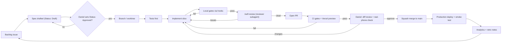

# Daniel Dominic Portfolio — Agentic Development Workflow

> **Companion to:** `docs/plan.md` (v1.1) (the _what_). This document is the _how_.  
> **Version:** 1.1 — 21 October 2026 (Sprint 0 decisions applied; see `docs/specs/sprint-0-foundation.md`)  
> **Primary dev agent:** Claude Code  
> **Human role:** Daniel — product owner, architect, reviewer, and the only one who merges and ships.

---

## 1. Operating principles

1. **Humans decide, agents execute.** Daniel owns specs, architecture decisions, content claims, review, merge and release. Claude Code writes code, tests, scripts and drafts.
2. **Spec before code.** No implementation starts without a written spec with acceptance criteria that Daniel has approved.
3. **Small vertical slices.** One feature or fix per branch and PR, ideally under ~400 changed lines. Big diffs are where agents hide mistakes.
4. **Tests are the contract.** A slice is done when its acceptance criteria are encoded as tests and every gate is green — not when the agent says it's done.
5. **Context lives in the repo.** `CLAUDE.md`, specs, ADRs and the plan are versioned files, so every session (and every subagent) starts with the same knowledge.
6. **Deterministic guardrails over instructions.** Anything that must always happen (formatting, type checks, blocked paths, secrets) is enforced by hooks, CI or permissions, not just by asking nicely in a prompt.
7. **Real-device truth.** Emulated mobile tests catch most issues; a real mid-range Android phone and an iPhone get the final word before merge.

---

## 2. The cycle at a glance



| Stage              | Who                                                                                     | Output                                                 | Exit condition                      |
| ------------------ | --------------------------------------------------------------------------------------- | ------------------------------------------------------ | ----------------------------------- |
| 1. Backlog         | Daniel (Claude drafts)                                                                  | GitHub issue with goal + link to plan section          | Issue is small enough for one PR    |
| 2. Spec            | Claude drafts (`/spec`, no plan mode; `Status: Draft` + stop is the gate), Daniel edits | `docs/specs/<feature>.md` with `Status: Draft`         | Daniel sets `Status: Approved`      |
| 3. Branch          | Claude                                                                                  | `feat/<feature>` branch or git worktree                | Clean tree, up to date with `main`  |
| 4. Tests first     | Claude                                                                                  | Failing unit / component / e2e tests from the criteria | Tests fail for the right reason     |
| 5. Implement       | Claude                                                                                  | Code in small commits                                  | Tests pass locally                  |
| 6. Local gates     | Hooks (automatic)                                                                       | Format, lint, typecheck, unit tests                    | All green                           |
| 7. Self-review     | `/self-review` → `reviewer` subagent                                                    | Review notes, fixes applied                            | No blocking findings                |
| 8. PR              | Claude                                                                                  | PR with template filled, screenshots                   | CI triggered                        |
| 9. CI + preview    | GitHub Actions + Vercel                                                                 | Gate results, preview URL                              | All required checks green           |
| 10. Human review   | Daniel                                                                                  | Approve / request changes                              | Diff read, preview checked on phone |
| 11. Merge + deploy | Daniel                                                                                  | Squash merge → production                              | Post-deploy smoke test passes       |
| 12. Learn          | Daniel + Claude                                                                         | Retro note, `CLAUDE.md` / spec updates                 | Lessons written back into the repo  |

---

## 3. Toolchain

| Concern                | Tool                                                                       | Notes                                                                                                        |
| ---------------------- | -------------------------------------------------------------------------- | ------------------------------------------------------------------------------------------------------------ |
| Framework              | Next.js (App Router) + TypeScript (strict)                                 | Per plan §9                                                                                                  |
| Package manager        | pnpm                                                                       | Fast, strict dependency resolution                                                                           |
| Styling / UI           | Tailwind CSS, Radix primitives, Motion                                     | Per plan                                                                                                     |
| 3D                     | React Three Fiber, drei, Three.js                                          | Dynamic import, `ssr: false`                                                                                 |
| Lint / format          | ESLint + Prettier                                                          | Run by hooks and CI                                                                                          |
| Unit / component tests | Vitest + Testing Library                                                   | Fast feedback for the agent loop                                                                             |
| End-to-end             | Playwright                                                                 | Projects for Pixel-class Android, iPhone, desktop                                                            |
| Visual regression      | Playwright screenshots (`toHaveScreenshot`)                                | From Phase 1. Baselines generated on Linux, updated only by the Daniel-triggered `update-snapshots` workflow |
| Accessibility          | `@axe-core/playwright`                                                     | Fails on serious/critical violations                                                                         |
| Performance            | Lighthouse CI                                                              | Mobile budgets per route, run against a local production build in CI                                         |
| Bundle size            | Lighthouse CI script-size assertion; `@next/bundle-analyzer` for diagnosis | Fails if JS budget exceeded; analyzer added when first needed                                                |
| 3D asset checks        | `gltf-transform` CLI + custom budget script                                | Size, triangles, textures per `/explore` budget                                                              |
| Links / content        | Link checker + claims check script                                         | Catches dead Play Store / LinkedIn links                                                                     |
| CI                     | GitHub Actions                                                             | Required checks on every PR                                                                                  |
| Hosting                | Vercel                                                                     | Preview deploy per PR, production on `main`                                                                  |
| Source of truth        | GitHub (issues, PRs, projects board)                                       | Backlog and history in one place                                                                             |

---

## 4. Repository context for the agent

### 4.1 Files Claude Code reads every session

```text
portfolio/
├── CLAUDE.md                  # Project memory: stack, commands, rules, don'ts
├── docs/
│   ├── plan.md                # the product plan (was portfolio-plan-v1.1.md)
│   ├── workflow.md            # this document
│   ├── specs/                 # one spec per feature, written before code
│   │   └── _template.md
│   ├── adr/                   # architecture decision records
│   │   └── 0001-nextjs-r3f-stack.md
│   ├── content/
│   │   └── claims.md          # every public claim + its source (resume line, link)
│   └── private/               # gitignored: open questions, permissions, unverified items
├── assets-raw/                # downloaded 3D packs, never shipped (.gitignore)
├── LICENSES-ASSETS.md         # attribution for every third-party asset
└── .claude/
    ├── settings.json          # permissions + hooks (committed)
    ├── agents/                # subagents
    └── skills/                # repeatable workflows (slash commands)
```

### 4.2 `CLAUDE.md` skeleton

```markdown
# Portfolio — project guide for Claude

## What this is

Personal portfolio for Daniel Dominic (senior Android engineer). Plan: docs/plan.md.
Mobile-first. Content is 2D and must never depend on WebGL. 3D lives at /explore only.

## Commands

- pnpm dev | pnpm build | pnpm lint | pnpm typecheck
- pnpm test (Vitest) | pnpm e2e (Playwright) | pnpm e2e:mobile
- pnpm verify # format:check, lint, typecheck, test, build, e2e
- pnpm verify:full # verify + Lighthouse CI
- Phase 4, not yet available: pnpm assets:optimize | pnpm assets:check

## Rules

- Work only from a spec in docs/specs/ marked `Status: Approved`. Only Daniel sets that.
  If none exists, write one with `Status: Draft` and stop.
- Write or update tests before implementation. Never delete or skip a failing test to get green.
- Server components by default; "use client" only where interaction needs it.
- Every public claim must exist in docs/content/claims.md with a source. Never invent metrics.
- No new dependency without stating why in the PR description.
- Keep PRs small: one spec per PR.

## Never

- Push to main, merge PRs, or deploy to production.
- Update visual-regression baselines. Daniel runs the update-snapshots workflow.
- Commit anything from assets-raw/, .env*, or employer-confidential material.
- Add camera/AR (getUserMedia, WebXR) features — out of scope.

## Definition of done

Spec criteria covered by tests · pnpm verify green · /self-review clean ·
PR template complete with mobile screenshots.
```

### 4.3 Spec template (`docs/specs/_template.md`)

```markdown
# <Feature name>

Plan reference: docs/plan.md §<section> Issue: #<n>
Status: **Draft** <!-- only Daniel changes this to Approved -->

## Goal

One or two sentences: what the visitor can do after this ships.

## Scope / Out of scope

## Acceptance criteria (each becomes ≥1 test)

- [ ] AC1 …
- [ ] AC2 …

## UX notes (mobile first)

## Technical approach

Components, data, routes. Link an ADR if a real decision is made.

## Test plan

Unit · component · e2e (which viewports) · a11y · perf budget touched?

## Risks / open questions
```

### 4.4 ADRs

Write a short ADR (context → decision → consequences) whenever a choice would be expensive to reverse: framework, 3D library, hosting, analytics provider, asset sources. Claude drafts it; Daniel accepts it. The reviewer subagent checks new code against accepted ADRs.

---

## 5. Claude Code setup

> How §5.1–5.2 are implemented (Bash coverage, `rm` and `main` rules enforced by hooks/branch protection, Stop-hook guards, ask-first configs) is set in `docs/specs/sprint-0-foundation.md`, W2–W5, W7 and W12.

### 5.1 Permissions (`.claude/settings.json`)

- **Allow without prompting:** `pnpm` scripts (`lint`, `test`, `e2e`, `build`, `verify`, `assets:*`), `git status/diff/log/add/commit`, `git checkout -b`, `gh issue view`, `gh pr create`, read/write under `app/`, `components/`, `content/`, `data/`, `lib/`, `tests/`, `docs/specs/`.
- **Ask first:** `pnpm add` (new dependencies), `git push`, edits to `CLAUDE.md`, `.claude/`, `.github/`, `docs/adr/`.
- **Deny:** reading `.env*`, `git push --force`, pushing to `main`, `gh pr merge`, `vercel --prod`, `rm -rf` outside `.next/` and `test-results/`.

### 5.2 Hooks (deterministic guardrails)

Sprint 0 builds only **format on write** and **protected paths** (`.claude/hooks/*.mjs`, Node scripts with unit-tested decision functions in `tests/unit/hooks/`). Done check and session context are deferred until a real need appears (Sprint 0 spec, Q8).

| Hook            | Trigger                                                                                       | Action                                                                                                                                                                                                                     |
| --------------- | --------------------------------------------------------------------------------------------- | -------------------------------------------------------------------------------------------------------------------------------------------------------------------------------------------------------------------------- |
| Format on write | `PostToolUse` on Edit/Write of `*.ts(x)`, `*.(m)js`, `*.md(x)`, `*.css`, `*.json`, `*.y(a)ml` | ESLint `--fix` + Prettier on code, Prettier only on the rest; report remaining ESLint problems back to Claude                                                                                                              |
| Protected paths | `PreToolUse` on Edit/Write/NotebookEdit, and Bash/PowerShell                                  | Block writes to `.env*`, `assets-raw/`, visual baselines, `public/resume/`; explain why. Shell commands are checked best-effort (redirects, `cp`/`mv`/`rm`/`tee`, Playwright `-u`, recursive deletes outside build output) |
| Done check      | `Stop`                                                                                        | Run `pnpm typecheck && pnpm test --changed`; if red, tell Claude to keep going instead of finishing                                                                                                                        |
| Session context | `SessionStart`                                                                                | Print current branch, open spec, and `git status` so each session starts oriented                                                                                                                                          |

### 5.3 Subagents (`.claude/agents/`)

Sprint 0 builds only **`reviewer`**. `content-checker` comes with Phase 0 claims; `test-writer` and `perf-a11y-auditor` are deferred, since CI already enforces tests and budgets (Sprint 0 spec, Q8).

| Agent                        | Tools                                    | Job                                                                                                                                                                                                                 |
| ---------------------------- | ---------------------------------------- | ------------------------------------------------------------------------------------------------------------------------------------------------------------------------------------------------------------------- |
| `reviewer`                   | Read-only + run tests                    | Reviews the branch diff against the spec, ADRs and `CLAUDE.md`; flags bugs, missing tests, a11y issues, scope creep. Never edits: its tool list has no Edit/Write, and its prompt forbids writes through Bash (W9). |
| `test-writer`                | Read + write under `tests/`              | Turns acceptance criteria into Vitest/Playwright tests before implementation                                                                                                                                        |
| `perf-a11y-auditor`          | Read + run Lighthouse/axe/bundle scripts | Runs budgets on the preview or local build and reports regressions with likely causes                                                                                                                               |
| `content-checker`            | Read-only                                | Compares every number, title, date and link in `content/` against `docs/content/claims.md`; flags anything unsourced                                                                                                |
| `asset-pipeline` _(Phase 4)_ | Read + run `assets:*` scripts            | Optimizes new 3D assets, checks budgets, updates `LICENSES-ASSETS.md`                                                                                                                                               |

Using a separate reviewer means the code isn't graded by the same context that wrote it.

### 5.4 Skills / slash commands (`.claude/skills/`)

Sprint 0 builds only **`/spec`**, **`/self-review`** and **`/pr`**. `/implement`, `/ci-fix` and `/retro` are deferred; until then, the stages they would run happen by hand in the session (Sprint 0 spec, Q8).

| Command                         | What it does                                                                                                                                                                                                                          |
| ------------------------------- | ------------------------------------------------------------------------------------------------------------------------------------------------------------------------------------------------------------------------------------- |
| `/spec <issue>`                 | Read the issue, plan section and ADRs; ask Daniel what the repo can't answer; write `docs/specs/<feature>.md` from the template with `Status: Draft`; stop for approval. Skips plan mode, so `Status: Draft` + stop is the gate (W1)  |
| `/implement <spec>`             | Refuse unless `Status: Approved` → create branch → call `test-writer` → implement in small commits until tests pass → run `pnpm verify`                                                                                               |
| `/self-review`                  | Run `reviewer` on the branch diff; apply its mechanical fixes; list judgement calls for Daniel. Until `content-checker` exists, check claims against `claims.md` by hand                                                              |
| `/pr`                           | Daniel-only (`disable-model-invocation`). Fill the PR template (AC → test map, proof of red, decisions to review), push, open the PR with `gh`. Screenshots are captured locally for Daniel to attach, since `gh` can't upload images |
| `/ci-fix`                       | Read failing CI logs, reproduce locally, fix, push to the same branch                                                                                                                                                                 |
| `/add-asset <file>` _(Phase 4)_ | Run the 3D asset pipeline (§7) on a new model and report budget impact                                                                                                                                                                |
| `/retro`                        | Summarize what went wrong/right on the merged PR and propose `CLAUDE.md` edits for Daniel to approve                                                                                                                                  |

### 5.5 MCP servers (optional, add when needed)

- **Playwright MCP** — lets Claude open the local or preview site, take screenshots at phone sizes and check its own UI work visually.
- **GitHub MCP** (or the `gh` CLI) — issues, PRs, CI logs.
- Keep the set small; every server adds context and attack surface.

### 5.6 Parallel work

Run at most two agent streams at once, each in its own **git worktree** (for example, a content page and the 3D scene). They must touch different folders. Daniel reviews and merges them one at a time.

---

## 6. Testing strategy

| Layer             | What it proves                                                   | Tool                                               | Runs                                             |
| ----------------- | ---------------------------------------------------------------- | -------------------------------------------------- | ------------------------------------------------ |
| Static            | Types, lint, formatting                                          | `tsc`, ESLint, Prettier                            | Hooks + CI                                       |
| Unit              | Data helpers, metadata, project model, quality gate logic        | Vitest                                             | Hooks (changed) + CI (all)                       |
| Component         | Cards, nav, panels, Architecture Explorer behaviour              | Vitest + Testing Library                           | CI                                               |
| End-to-end        | Real user journeys (below) on mobile + desktop                   | Playwright                                         | CI on every PR                                   |
| Visual regression | Layout didn't shift unexpectedly                                 | Playwright screenshots, 3 viewports                | CI on every PR (from Phase 1)                    |
| Accessibility     | WCAG 2.2 AA basics, keyboard paths                               | axe + Playwright keyboard tests                    | CI on every PR                                   |
| Performance       | Core Web Vitals proxies, JS budget                               | Lighthouse CI (mobile), bundle check               | CI on every PR                                   |
| 3D                | Scene loads, hotspots work, fallback works, assets within budget | Playwright (WebGL on and off), asset budget script | CI on PRs touching `/explore` or `public/models` |
| Content           | No dead links, no unsourced claims                               | Link checker, `content-checker` agent              | CI + before release                              |
| Real device       | Touch feel, frame rate, tilt permission, readability             | Daniel on a mid-range Android phone + iPhone       | Before merging UI work                           |

### Core e2e journeys (must always pass)

1. Phone visitor lands on `/`, understands the role, taps **Explore My Work**, opens the CASABOT case study.
2. Visitor downloads the resume PDF (200 OK, correct file).
3. Visitor reaches contact from any page in ≤ 2 taps.
4. `/explore` with WebGL: scene loads, tapping the phone object opens the work panel, **List view** reaches every section.
5. `/explore` with WebGL disabled: poster + List view shown automatically, no errors in console.
6. Keyboard-only: navigate home → work → case study → contact.

### Budgets that fail CI

| Budget                                             | Limit           |
| -------------------------------------------------- | --------------- |
| Lighthouse mobile performance (home, case study)   | ≥ 90            |
| Lighthouse accessibility                           | ≥ 95            |
| Home page JS (script transfer size, Lighthouse CI) | ≤ 150 KB        |
| `/explore` scene download                          | ≤ 5 MB          |
| Scene triangles / draw calls                       | ≤ ~150K / ≤ 100 |
| axe serious/critical violations                    | 0               |

Start budgets slightly loose if needed and tighten after the first stable release; never loosen them silently in a feature PR.

---

## 7. 3D asset workflow (packs instead of Blender)

**Decision:** start from ready-made, license-cleared low-poly assets and an HDRI environment instead of modeling in Blender. Revisit custom modeling only if the packs can't express the concept.

### Sources to evaluate

| Source             | License to check                               | Good for                                   |
| ------------------ | ---------------------------------------------- | ------------------------------------------ |
| Kenney asset packs | CC0                                            | Furniture, props, consistent style         |
| Quaternius         | CC0                                            | Stylized low-poly props and rooms          |
| Poly Pizza         | Per model (CC0 or CC-BY)                       | Individual objects (headset, plant, robot) |
| Sketchfab          | Per model (check commercial/attribution terms) | Specific hero objects if needed            |
| Poly Haven         | CC0                                            | HDRI environment lighting, textures        |

Prefer **one or two packs with a matching style** over many mismatched models. Check each license before download and record it.

### Pipeline (automated by the `asset-pipeline` agent)

```text
download → assets-raw/<pack>/            (not shipped)
        → pnpm assets:optimize            gltf-transform: dedupe, weld, Meshopt/Draco,
                                          resize textures (≤1024px), KTX2/WebP
        → public/models/workspace.glb     single merged scene where possible
        → pnpm assets:check               fails if over size/triangle/texture budget
        → LICENSES-ASSETS.md updated      source URL, author, license, attribution text
        → poster.webp regenerated         static fallback image for /explore
```

### Human-only decisions

- Choosing which pack and objects fit the visual direction (agents are poor judges of style).
- Final scene composition and camera angles — Claude proposes positions in code; Daniel adjusts on a real phone.
- Approving any attribution requirement before a model ships.

---

## 8. Git, PRs and release

### Branching

- Trunk-based: `main` is always deployable; short-lived `feat/*`, `fix/*`, `content/*`, `chore/*` branches.
- Conventional commits (`feat:`, `fix:`, `test:`, `docs:`, `chore:`), so the changelog writes itself.
- Squash merge; branch deleted after merge.
- Branch protection on `main`: PR required (0 approvals, since Daniel authors every PR), all CI checks required, no force-push.

### PR template (`.github/pull_request_template.md`)

```markdown
## What / why

Spec: docs/specs/<feature>.md · Closes #<issue>

## Acceptance criteria

- [ ] AC1 — test: <file>
- [ ] AC2 — test: <file>

## Screenshots (mobile 390px, desktop 1440px)

## Checks

- [ ] pnpm verify green locally
- [ ] /self-review (reviewer subagent): no blocking findings
- [ ] No new dependency (or justified below)
- [ ] No unsourced claims (content-checker run if content changed)
- [ ] Tested on a real phone (UI changes)
```

### CI pipeline (GitHub Actions, on every PR)

```text
install (pnpm, cached)
 ├─ static: format:check + lint
 ├─ typecheck
 ├─ unit + component tests
 ├─ build
 │   └─ asset budget check (if public/models changed; Phase 4)
 ├─ Playwright e2e + axe (+ visual from Phase 1)  (Android, iPhone, desktop projects)
 ├─ Lighthouse CI (mobile) on a local production build, incl. JS budget
 └─ link check (from Phase 1)
```

### Release

1. Daniel merges to `main` → Vercel production deploy.
2. Post-deploy smoke test (Playwright against production: home, one case study, resume download, `/explore` loads).
3. If smoke test fails → revert the merge commit (one click in Vercel or `git revert`), then fix forward on a branch.
4. Tag milestone releases (`v0.1-mvp`, `v0.2-explore`) with a short changelog.

---

## 9. Human checkpoints (non-negotiable)

| Checkpoint                             | Why it stays human                                   |
| -------------------------------------- | ---------------------------------------------------- |
| Approving each spec                    | Decides what gets built and how much                 |
| Every public claim and case-study text | Accuracy, NDA and employer permissions               |
| Reading the PR diff                    | Agents can pass tests while doing the wrong thing    |
| Real-phone check for UI                | Feel, readability and touch can't be fully automated |
| Updating visual baselines              | Prevents "fixing" a regression by accepting it       |
| Merge and production deploy            | Accountability for what's public                     |
| Choosing 3D assets and licenses        | Style judgement and legal responsibility             |

---

## 10. Phase-by-phase mapping

| Plan phase                      | Workflow focus                                                                                                                       | Notable agent work                                                                            |
| ------------------------------- | ------------------------------------------------------------------------------------------------------------------------------------ | --------------------------------------------------------------------------------------------- |
| **Sprint 0 — Foundation** (new) | Repo scaffold, CI, hooks, `CLAUDE.md`, subagents, skills, Vercel, branch protection, one trivial page shipped through the full cycle | Claude scaffolds everything; Daniel reviews config carefully — it governs every later session |
| Phase 0 — Content audit         | Mostly human; Claude drafts copy and `claims.md` from the resume                                                                     | `content-checker` set up early                                                                |
| Phase 1 — Design system + home  | Tokens, layout, components, home page                                                                                                | Visual baselines established here                                                             |
| Phase 2 — Case studies          | MDX pipeline, case-study components, four pages                                                                                      | `content-checker` on every content PR                                                         |
| Phase 3 — Lab MVP               | Architecture Explorer as standalone component                                                                                        | Component tests for every node interaction                                                    |
| Phase 4 — 3D Workspace          | Asset pipeline, `/explore`, fallback, tilt mode                                                                                      | `asset-pipeline` + 3D e2e + budgets                                                           |
| Phase 5 — Launch                | Domain, SEO, analytics, release tag                                                                                                  | Production smoke tests, link check                                                            |

**Sprint 0 is the most important step:** prove the whole loop (spec → tests → PR → CI → preview → merge → deploy) on a tiny "Hello" page before building anything real.

---

## 11. Workflow health

Track lightly, review every couple of weeks:

- **PR cycle time** (spec approved → merged). Rising means slices are too big.
- **CI first-pass rate.** Falling means local gates or `CLAUDE.md` are missing something.
- **Rework after human review.** Recurring comment → turn it into a rule, a hook or a test.
- **Budgets trend** (Lighthouse, JS, scene size).

Every repeated correction should end up in `CLAUDE.md`, a hook, a test or a subagent prompt — so it's fixed once, not every session.

---

## 12. Risks and mitigations

| Risk                                           | Mitigation                                                                          |
| ---------------------------------------------- | ----------------------------------------------------------------------------------- |
| Agent drifts from the plan or invents features | Spec-first rule, reviewer subagent checks scope, small PRs                          |
| Tests weakened to get green                    | `CLAUDE.md` rule, reviewer flags deleted/skipped tests, baselines protected by hook |
| Invented or overstated career claims           | `claims.md` source of truth + `content-checker` + human sign-off                    |
| Employer-confidential material leaks           | Never-commit rules, protected paths, human review of every media asset              |
| Dependency bloat slows mobile                  | New deps need approval; bundle budget in CI                                         |
| 3D scene too heavy on phones                   | Asset budget script, Lighthouse on `/explore`, automatic low-end fallback           |
| Asset license problems                         | `LICENSES-ASSETS.md`, CC0-first sources, human approval                             |
| Flaky e2e tests erode trust                    | Retry once in CI, quarantine label, fix within the next PR                          |
| Context loss between sessions                  | Everything important lives in repo files, not chat history                          |

---

## 13. First steps

1. Create the GitHub repo and copy `portfolio-plan-v1.1.md` and this file into `docs/`.
2. Open Claude Code in the repo and run Sprint 0 as its first spec: scaffold, CI, hooks, `CLAUDE.md`, subagents, skills, Vercel preview.
3. Ship a placeholder home page through the full cycle to prove every gate works.
4. Pick 2–3 candidate asset packs and an HDRI; prototype the desk composition in a throwaway branch.
5. Start Phase 0 content work in parallel (claims, case-study drafts, permissions).
